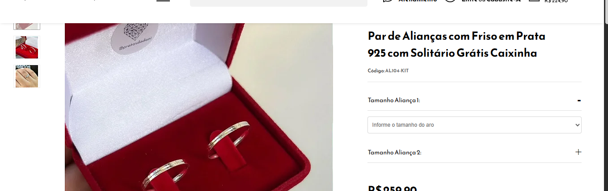
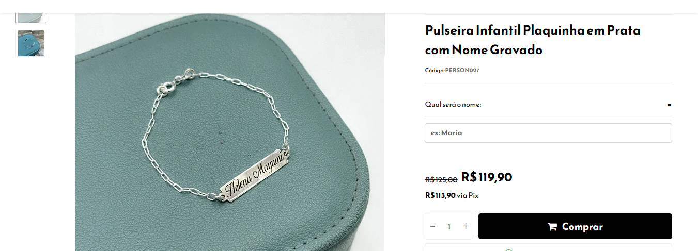
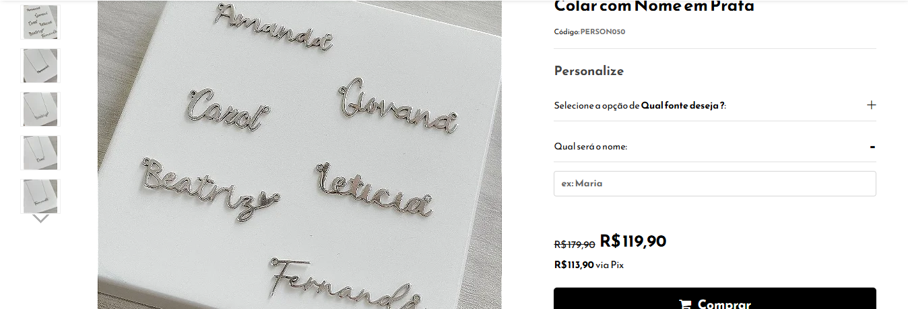
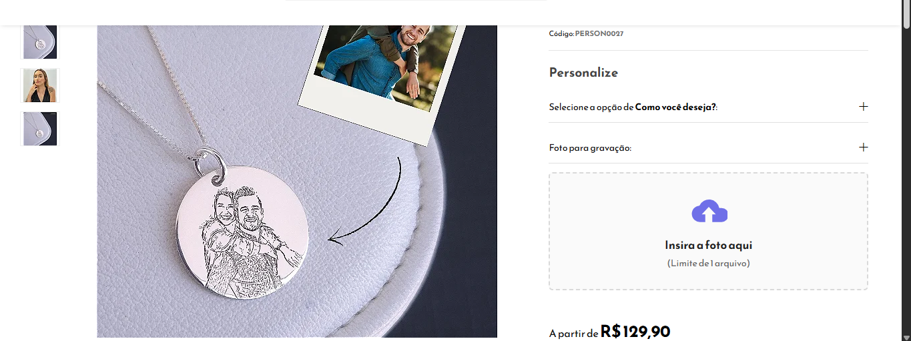

# Automação de Personalização para E-commerce

## Sobre o projeto

Este projeto surgiu da identificação de uma necessidade operacional em uma loja virtual de joias em prata: simplificar o processo de personalização dos produtos e reduzir etapas manuais entre a realização do pedido e o início da produção.

Anteriormente, algumas informações necessárias para a confecção das peças precisavam ser solicitadas ao cliente após a compra. Era necessário entrar em contato, aguardar respostas, confirmar tamanhos, receber nomes, textos e fotografias. Essa dependência de comunicação manual poderia atrasar o encaminhamento dos pedidos para produção.

A proposta foi desenvolver uma solução que permitisse ao cliente informar os dados de personalização diretamente na página do produto, durante a compra, facilitando a organização das informações necessárias para a produção.

## Objetivos

- Reduzir etapas manuais no processo de personalização.
- Facilitar o preenchimento das informações pelo cliente.
- Automatizar o encaminhamento dos dados para uma planilha.
- Centralizar informações relevantes para a produção.
- Simplificar o recebimento e armazenamento de fotografias.

## Funcionalidades desenvolvidas

- Seleção independente de dois tamanhos para pares de alianças.
- Campos para informar nomes e textos personalizados.
- Upload de fotografias diretamente pela página do produto.
- Pré-visualização das imagens selecionadas.
- Validação de formato e tamanho dos arquivos.
- Integração com Cloudinary para hospedagem de imagens.
- Integração com Google Apps Script e Google Planilhas para organização dos dados.
- Controle de tentativas de envio para evitar reenvios desnecessários.

## Tecnologias utilizadas

- HTML — estrutura dos elementos.
- CSS — estilização dos componentes.
- JavaScript — lógica e comportamento das funcionalidades.
- jQuery — manipulação de elementos e eventos.
- Google Apps Script — processamento dos dados recebidos.
- Google Planilhas — armazenamento e organização das informações.
- Cloudinary — hospedagem das fotografias.
- Loja Integrada — plataforma de e-commerce utilizada no projeto.
- GitHub — versionamento e documentação do código.

## Arquitetura da solução

A solução é composta por três partes principais:

### 1. Interface de personalização

Desenvolvida com HTML, CSS, JavaScript e jQuery, permite que o cliente informe os dados necessários para personalizar os produtos diretamente na página de compra.

A interface contempla campos específicos para tamanhos de alianças, nomes, textos e envio de fotografias.

### 2. Gerenciamento de fotografias

O upload das imagens é realizado por meio da API do Cloudinary.

O processo contempla validação de formato e tamanho, pré-visualização da imagem, tratamento de erros e armazenamento do endereço da fotografia no campo de personalização.

### 3. Integração com Google Planilhas

O Google Apps Script recebe os dados encaminhados pelo frontend e organiza as informações em uma planilha.

O registro contempla data e hora, produto, SKU, detalhes da personalização e endereço da fotografia.

## Fluxo de funcionamento

1. O cliente acessa a página do produto.
2. Preenche os campos de personalização disponíveis.
3. Quando necessário, seleciona e envia uma fotografia.
4. A imagem é hospedada no Cloudinary.
5. O endereço da imagem é associado aos dados de personalização.
6. Na etapa do carrinho, o frontend identifica os produtos personalizados.
7. Os dados são encaminhados à integração com Google Apps Script.
8. O Apps Script processa as informações e realiza o registro na planilha.

## Desafios técnicos

Um dos principais desafios foi desenvolver uma solução compatível com as limitações da Loja Integrada.

Durante o desenvolvimento, identifiquei uma limitação relacionada à execução de scripts personalizados no checkout da plataforma. Isso exigiu repensar a estratégia de integração e adaptar o fluxo para realizar o encaminhamento das informações a partir da página do carrinho, sem depender de novas ações do cliente no checkout.

Outro desafio foi integrar serviços externos, organizar os dados recebidos e tratar situações como falhas no upload de imagens e tentativas de envio.

## Segurança e tratamento de dados

Durante o desenvolvimento, foram considerados alguns cuidados técnicos:

- Validação dos dados recebidos antes do processamento.
- Limitação do tamanho e dos formatos de imagens aceitos pelo frontend.
- Tratamento de erros nas operações de upload.
- Proteção contra interpretação de dados fornecidos pelo usuário como fórmulas em planilhas.
- Controle de concorrência no registro das informações.
- Utilização de configurações fictícias na versão disponibilizada para portfólio.

A implementação demonstrativa utiliza placeholders para endereços e configurações de serviços externos. O token presente no frontend não deve ser considerado um mecanismo seguro de autenticação, pois valores inseridos em JavaScript no navegador podem ser visualizados pelos usuários.

Além disso, a comunicação com o Google Apps Script utiliza o modo `no-cors`, que não permite ao navegador confirmar se os dados foram efetivamente gravados na planilha.

Por esse motivo, a versão documentada no GitHub representa uma demonstração técnica, não uma configuração pronta para implantação em produção.

## Utilização de Inteligência Artificial

A Inteligência Artificial foi utilizada como ferramenta de apoio durante o desenvolvimento, auxiliando na análise de códigos, criação e ajustes de scripts, investigação de erros e identificação de alternativas técnicas.

As decisões sobre a implementação, os testes e a validação do funcionamento foram conduzidos durante o desenvolvimento do projeto.

## Aprendizados

A experiência proporcionou conhecimentos práticos em:

- Desenvolvimento web com JavaScript e jQuery.
- Manipulação de elementos e eventos no frontend.
- Integração com APIs e serviços externos.
- Automação de processos operacionais.
- Manipulação e organização de dados.
- Tratamento de erros e validação de informações.
- Segurança no desenvolvimento de aplicações.
- Versionamento de código com GitHub.
- Utilização de Inteligência Artificial como ferramenta de apoio ao desenvolvimento.

## Estrutura do repositório

```text
automacao-personalizacao-ecommerce/
│
├── docs/
│   ├── images/
│   └── README.md
│
├── frontend/
│   ├── personalizacao-produtos.html
│   └── README.md
│
├── integrations/
│   ├── google-apps-script.gs
│   └── README.md
│
└── README.md
```

## Demonstração das funcionalidades

A solução contempla diferentes necessidades de personalização, permitindo que as informações sejam preenchidas diretamente na página do produto.

### 1. Personalização de alianças

Seleção independente dos tamanhos de cada aliança no mesmo pedido.



### 2. Gravação de nomes em peças

Campo para informar o nome que será utilizado na gravação do produto.



### 3. Colar personalizado

Personalização do colar com inserção do nome e escolha da fonte.



### 4. Personalização com fotografia

Upload de fotografias diretamente na página do produto, com integração ao Cloudinary.



---

Mais do que implementar funcionalidades, este projeto demonstrou como a tecnologia pode ser aplicada para solucionar necessidades operacionais de um negócio, conectando desenvolvimento web, integração de serviços e automação de processos.
